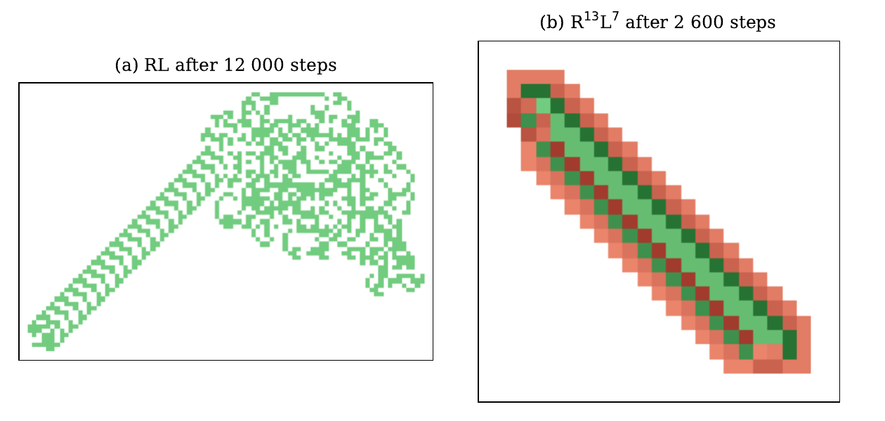
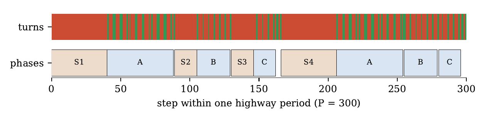

# Highways of the RⁿLᵐ ants from the blank grid

Code, data and formal proofs for the generalised Langton ants RⁿLᵐ started on the blank grid. The repository
contains a period law for the whole family, proved in Lean 4, and its extension to every rule that begins
with the right prefix. It also contains experiments on the chaotic transients of the other rules. It is the
companion repository of the paper *Highways of the RⁿLᵐ ants from the blank grid: a formally verified period
law* (in preparation).



*(a) Langton's ant RL after 12,000 steps: about ten thousand steps of chaos, then the highway of period 104.
(b) R¹³L⁷ after 2,600 steps: a 354-step transient, then a highway of period 300 = 16·(13 + 7) − 20.*

**The model.** A rule is a word w ∈ {R, L}ᴺ. On a cell in state c the ant turns right if w_c = R and left
if w_c = L, sets the cell to c + 1 mod N, and steps forward. RⁿLᵐ is n letters R followed by m letters L.
All results are for the blank start: every cell in state 0.

## Results at a glance

| | Result | Status |
|---|---|---|
| 1 | **Period law.** For odd m ≥ 3 and n ≥ m − 1, except (12, 13), RⁿLᵐ enters a highway of period 16(n + m) − 20 within 204(n + m) steps. | Proved in Lean 4 |
| 2 | **The RⁿL family.** For n ≥ 2, RⁿL enters a highway of period 16n + 4 within 40(n + 1) steps. | Proved in Lean 4 |
| 3 | **Prefix inheritance.** Every rule that begins with RⁿLᵐRⁿL follows exactly the trajectory of RⁿLᵐ (odd m, n ≥ m). | Proved in Lean 4 |
| 4 | **Concrete highways.** Langton's ant, the exception (12, 13), and twelve non-diagonal highways from the blank grid. | Proved in Lean 4 |
| 5 | **Anatomy of a period.** Four spirals and six staircases explain the formula 16(n + m) − 20. | Derived by hand, checked against a certificate |
| 6 | **Chaotic transients.** The number of new cells an ant explores before its highway is approximately exponential, with a rate that belongs to the rule. | Experimental (144 rules) |
| 7 | **Rules as rotation angles.** Highways sit in "tongues" around α = 1/(n + 1); the golden angle is not special. | Experimental; the tongues follow from 3 |
| 8 | **Covering an n×n torus.** Rules with an early highway need about n² steps; chaotic rules need about n^2.9. | Experimental |

None of the formal results uses Mathlib or `sorry`. The trusted base is described [below](#what-has-to-be-trusted).

## 1. The period law

**Theorem.** Let m = 2j + 1 ≥ 3 and n ≥ m − 1 (n ≥ 3 when m = 3), with (n, m) ≠ (12, 13). Started on the
blank grid, RⁿLᵐ is a highway with onset at most 204(n + m) and period P = 16(n + m) − 20. The certificates
give the drift (±2, ±2). If n = 3j or (n, m) = (4, 5), then P/2 is already a period.

| n | m | measured onset | minimal period | 16(n + m) − 20 |
|---|---|---|---|---|
| 5 | 5 | 178 | 140 | 140 |
| 13 | 7 | 354 | 300 | 300 |
| 40 | 15 | 978 | 860 | 860 |
| 14 | 15 | 5,660 | 444 | 444 (slowest onset per state) |
| 12 | 13 | 12,440 | **996** | 380 (the exception) |

- **The exception is genuine.** From the blank grid, R¹²L¹³ builds a different highway, of period 996 and drift
  (6, −6). It is also proved in Lean, from step 13,436.
- **The period is minimal.** It was computed for all 575 pairs with odd 3 ≤ m ≤ 25 and m − 1 ≤ n ≤ 60. It equals
  P, or P/2 exactly in the cases above. The only other value is the 996 of the exception.
- **The hypotheses are sharp among small rules.** Among the RⁿLᵐ with m ≥ 2 and at most 12 states, those that build
  a highway within 3·10⁶ steps are exactly the ones covered by the theorem.

**How it is proved.** A search program runs the ant symbolically over affine families of (n, m): every
cell state is a form a + b·s + c·t. When the ant repeats a loop, the program runs all the repetitions in one
operation. It closes each family with a repetition lemma on a half-plane. The result is 42 certificates and
a case tree of 77 nodes. Lean checks them with a checker whose soundness is itself proved in Lean, so the
search program (Python) is not part of the trusted base.

```lean
theorem ley_m5 (n j : Nat) (hj : 2 ≤ j) (hn : 2*j ≤ n) (hex : ¬(n = 12 ∧ j = 6)) : Bueno n j
theorem ley_m3 (n : Nat) (hn : 3 ≤ n) : Bueno n 1
-- Bueno n j : ∃ t1 ≤ 204·(n+m), ∃ d, EsAutopista (RL n m) (iter (RL n m) t1 blank) (16·(n+m) − 20) d,  m = 2j+1
```

## 2. The RⁿL family

For every n ≥ 2, RⁿL enters a highway of period 16n + 4 within 40(n + 1) steps; for n = 2 the half period 18
is already a period (`ley_RnL`). For 3 ≤ n ≤ 40, the measured onset is exactly 24n + 6 and the minimal
period is 16n + 4. In the mirror notation LⁿR, the case n = 2k + 1 has period 32k + 20. That period was
announced without proof by Gajardo, Lutfalla and Rao, *Ants on the highway*, Natural Computing 24 (2025).

## 3. Prefix inheritance

From the blank grid, a cell visited k times has only read the states 0, 1, …, k − 1. So an ant that never
reads a state ≥ K behaves exactly like any other rule that agrees with it on its first K letters.

**Theorem.** Let m be odd and n ≥ m (or m = 1 and n ≥ 2), and let K = 2n + m + 1. Every rule whose first K
letters are RⁿLᵐRⁿL, whatever its length and its remaining letters, follows from the blank grid exactly the
same trajectory as RⁿLᵐ. In particular, it enters the same highway at the same step.

```lean
theorem herencia (n j : Nat) (hj : 1 ≤ j) (hn : 2*j + 1 ≤ n) (w : Regla)
    (hN : 2*n + (2*j+1) + 1 ≤ w.N)
    (hw : ∀ c, c < 2*n + (2*j+1) + 1 → w.der c = decide (c % (n + (2*j+1)) < n)) :
    MismaTray (RL n (2*j+1)) w blanco.toE blanco.toE ∧
    ∃ t1, t1 ≤ 204 * (n + 2*j + 1) ∧ ∃ d, EsAutopista w (iter w t1 blanco.toE) (16*(n + 2*j + 1) - 20) d
```

The proof uses a "lifted" copy of RⁿLᵐ with 3(n + m) states, whose states count visits. The same 19
certificates of the case tree (those with n ≥ m) are re-checked with a variant of the checker that also
proves no state above K − 1 is ever read. The variant's soundness is proved in Lean as well.

- **Part of the catalogue is inherited.** 169 of the 459 highways of the catalogue (37%) come from a shorter rule
  in this way.
- **The bound K looks sharp.** If the last letter of the prefix is changed, none of 320 random rules repeats the
  highway; this is observed only.
- **One case is left out.** The theorem does not cover the line n = m − 1, where the most visited cell reads further.

See `herencia/LEEME.md` for details.

## 4. Concrete highways proved in Lean

- **Langton's ant RL.** Period 104 and drift (−2, −2), proved from step 10,496; the observed onset is 9,976.
- **The exception R¹²L¹³.** Period 996 and drift (6, −6), proved from step 13,436.
- **Twelve non-diagonal highways from the blank grid.** They have reduced slopes 3:1, 1:3, 1:0, 0:1, 3:5, 5:7
  and 3:11. They are proved with a concrete checker based on a hash table, itself proved sound. The longest
  runs the ant for 1,640,238 steps, and the twelve proofs compile in about half a minute.

## 5. Why the period is 16(n + m) − 20



For j ≥ 2 and n ≥ 3j + 1, one period consists of four spirals around 2×2 blocks and six staircases:
S₁, A, S₂, B, S₃, C, S₄, A′, B′, C′ and twelve connecting steps. A spiral makes n − max(levels) laps. A
staircase pivot read twice per loop allows exactly j = (m − 1)/2 executions, because m is odd. The spirals
start at levels j and 3j, which are the levels the staircases leave behind. Adding up gives

  P = 4[2(n − j) + 2(n − 3j)] + 2[16j + 8j + 8(j − 1)] + 12 = 16n + 32j − 4 = 16(n + m) − 20.

When n = 3j the spirals S₂ and S₃ vanish, and the two halves of the period coincide.

## 6. Two regimes of the transient

The transients of the theorems are short and linear in the number of states. Most other rules are chaotic
first: Langton's ant takes about 10⁴ steps, and some rules take more than 10⁶.

- **The catalogue.** All 4,083 rules with 2 to 12 states (words starting with R, not constant) were run for 3·10⁶ steps
  from the blank grid. 474 build a highway: 462 diagonal and 12 not.
- **The waiting time is memoryless.** Across 144 chaotic rules, the number of new cells explored before the highway is
  approximately exponential. The median coefficient of variation is 1.01 (quartiles 0.92–1.11). Counted in
  steps, the waiting time does have memory.
- **The rate belongs to the rule.** Three kinds of random initial boards (41 rules, 400 runs each) barely change it:
  the Spearman correlation of the mean waits is 0.997 and 0.995. For Langton's ant the mean wait is 614, 742
  and 834 cells.

## 7. Rules as rotation angles (exploratory)

A rule can be written as the coding of a rotation: letter c is L when the turn c+1 → c+2 by an angle α
completes a full turn. α = 1/φ², the golden angle of phyllotaxis, gives the Fibonacci word
RLRRLRLRRLRR…

- **Highways sit in tongues.** For α ∈ [2/(2n+3), 1/(n+1)) the coding begins with RⁿLRⁿL, so it inherits the
  highway of RⁿL (result 3). This held for 222 of 222 words, and these intervals fill 36% of (0, 1/2).
- **The golden angle is not special.** The golden, silver and bronze rules with 13 to 60 states build 0/45, 0/44 and
  45/45 highways. The difference comes from the first letters of the word, not from how irrational α is: the first
  k letters explain 64% (k = 6) and 83% (k = 10) of the variance of the torus cover time.

See `exploracion/angulos/` and its figure `hormiga_angulos.png`.

## 8. Covering an n×n torus (exploratory)

The median number of steps to cover 90% of an n×n torus, for n = 32 to 512:

- **Rules with an early highway:** 10 n² → 22 n². The highway wraps around the torus and sweeps it lane by lane.
- **Chaotic rules:** 13 n² → 158 n².
- **A random walk, for comparison:** 15 n² → 50 n².

In the plane, chaotic ants visit about t^0.69 cells in t steps (interquartile range 0.66–0.71). This gives a
cover time of order n^2.9. This is consistent with the subdiffusion exponent 2/3 reported for flipping
rotators (Mishra, Bhattacharya, Webb and Cohen, 2015).

## Other observations

- **The fastest highway.** No highway in the catalogue is faster than 1/9, measured as (|dₓ| + |d_y|)/P. 128 rules
  reach it, all with period 18.
- **Finite tori.** Langton's ant passes through the all-black torus at exactly half its period on the 1×1, 1×2, 2×2,
  4×4 and 8×8 tori, where the period is 11,502,464 steps. On 16×16 nothing happens within 2·10¹⁰ steps.
- **Open questions.** Even m (for odd n), and n < m − 1, have no highway in our data but no proof either. The
  formula's geometry could give a computer-free proof of the regime n ≥ 3j + 1.

## What has to be trusted

The general theorems use only Lean's kernel and the standard axioms `propext`, `Classical.choice` and
`Quot.sound`. These are the soundness of both symbolic checkers, the repetition and loop lemmas, and the
coupling lemmas of the inheritance proof. The certificates (42 + 19), the concrete highways and the twelve
non-diagonal highways are evaluated with `native_decide`. That adds one axiom per certificate, listed by
`#print axioms`, and the Lean compiler to the trusted base.

## Repository layout

| Folder | Contents |
|---|---|
| `lean/` | The Lean 4 development: the model, the repetition and loop lemmas, the symbolic checkers and their soundness proofs, the certificates, the case tree, and the final theorems (`ley_m5`, `ley_m3`, `ley_RnL`, `herencia`, `herencia_RnL`, `herencia_palabra`). It also contains Langton's ant, the exception (12, 13) and the 12 non-diagonal highways. See `lean/LEEME.md`. |
| `prueba/` | The Python search engine that *finds* the certificates (symbolic execution, loop acceleration, case splitting) and exports them to Lean. Proof notes are in `prueba/DEMOSTRACION.md`. |
| `herencia/` | The prefix-inheritance theorem: its statement and proof outline, a Python replica of the lifted checker, and the generators of `SimbolicoU.lean` and `HerenciaCert.lean`. |
| `semillas/` | Experiments on chaotic transients: waiting times from random boards, robustness under three initial conditions, and seed sizes. |
| `exploracion/` | The catalogue of all 4,083 rules with 2–12 states (`pendientes.json`), tori and higher dimensions. `angulos/` holds the rotation-angle and torus-covering experiments. |
| `img/` | The figures of this README. |

Most notes inside the folders are in Spanish.

## Reproducing

**Formal proofs** (about one minute):
```bash
cd lean
lake build                               # needs elan: https://lean-lang.org/install/
lake env lean Hormiga/Verificacion.lean  # prints the statements and the axioms they use
```

**Regenerating the certificates** (Python 3):
```bash
cd prueba && python3 exporta.py m5 m3 m1 && python3 gen_lean.py native_decide   # lean/Hormiga/Certificados.lean
cd .. && python3 herencia/gen_simbolicoU.py && python3 herencia/gen_herencia.py  # inheritance files
```

**Experiments** (Python 3 with numpy, scipy and matplotlib, and gcc):
```bash
cd semillas && python3 experimento.py && python3 robustez.py && python3 robustez_analisis.py   # several hours
cd exploracion/angulos && gcc -O2 -o plano plano.c && gcc -O2 -o toro toro.c && python3 e1.py   # see its LEEME.md
```

## How this was made

The author posed the questions and directed the work. The simulators, the symbolic search engine and the
Lean formalisation were developed with an AI assistant (Claude, Anthropic). The correctness of the theorems
does not rest on trusting the assistant; it rests on the Lean development, which anyone can rebuild.

## Citation and license

If you use this material, please cite the paper (reference to be added on publication). Released under the
MIT License (see `LICENSE`).
